  
  <!-- Анимированный заголовок (можно заменить на статичную картинку/баннер) -->
  

  

  

    Creating open-source utilities, Studio plugins, automation tools, and quality-of-life scripts for the <b>Roblox</b> ecosystem.
  

  <!-- Бейджи для связи (замени ссылки на свои) -->
  

    
    
    
  

---

### 🛠️ About Me & Focus
- 🔧 **Main Focus:** Developing fast, reliable utilities for Roblox Studio, Open Cloud automation, and external workflow tools.
- 💡 **Philosophy:** Clean code, zero bloat, and clear documentation.
- 🌱 **Currently exploring:** Luau native codegen / Roblox Open Cloud API.
- 💬 **Open for:** Collaborations, bug reports, and utility ideas.

---

### ⚙️ Tech Stack & Tools

  <!-- Платформа и языки (удали лишнее, оставь то, на чем пишешь) -->
  
  
    
  <!-- Иконки остальных языков: py (Python), ts (TypeScript), js, cpp (C++), cs (C#), rust, go, git, vscode -->
  

---

### 🚀 What I Build
| Category | Description |
| :--- | :--- |
| **Studio Plugins** | Tools that speed up building, UI design, and asset management inside Roblox Studio. |
| **External Utilities** | CLI tools, Discord bots, and desktop apps interacting with Roblox APIs / Open Cloud. |
| **Luau Modules** | Lightweight, type-checked libraries ready to drop into any project (Wally / Rojo friendly). |

---

  ⭐ Check out my pinned repositories below! If a tool helped you, consider leaving a star.

